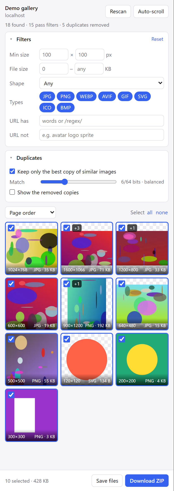

<p align="center">
  
</p>

<h1 align="center">Image Harvester</h1>

<p align="center">
  Grab every image on a web page, filter out the junk, drop the near-duplicates,<br>
  and download only the best copy of each picture.
</p>

<p align="center">
  
  
  
  
</p>

<p align="center">
  <picture>
    <source media="(prefers-color-scheme: dark)" srcset="docs/screenshot-dark.png">
    
  </picture>
</p>

---

## Why

The Network tab shows every image a page loads, but it's tedious to download
them from there. Image downloader extensions save everything, including the
150px thumbnail, the 800px version and the 1600px original of the same photo.

Image Harvester groups copies of the same picture with a **perceptual hash**,
the same technique [LibrePhotos](https://github.com/LibrePhotos/librephotos)
uses, and keeps only the highest-quality one.

## Features

- **Finds images other tools miss**
  - Everything the tab loads over the network, like DevTools' Network tab,
    including images fetched by scripts
  - Every size in `srcset` and `<picture>`, so you get the largest version, not
    just the one the page displayed
  - CSS backgrounds (including `::before` / `::after` and stylesheet rules),
    lazy-load attributes (`data-src`, `data-original`, …), links to full-size
    files, `og:image`, video posters, inline SVG, `<canvas>`, and `blob:` images
  - Works across iframes and open shadow DOM
  - **Auto-scroll** scrolls the page to trigger lazy loading and infinite scroll
- **Filters:** minimum width and height, file size range, shape
  (landscape/portrait/square), file type, and URL include/exclude with plain
  words or a `/regex/`
- **Duplicate removal:** a 64-bit pHash with an adjustable threshold. The best
  copy wins: most pixels, then biggest file, then best format.
- **Detects real formats:** reads each file's actual bytes, so a PNG served as
  `photo.jpg` is saved as `.png`
- **Downloads:** one ZIP or separate files, named after the page title
- **Light on memory:** the grid uses small thumbnails, and full-size images
  are decoded only two at a time
- **Private:** no servers, no analytics, no tracking. Everything happens in
  your browser.

## Install

The extension isn't on the Chrome Web Store yet. Load it from source:

1. Download this repo (**Code → Download ZIP**, then unzip) or clone it:
   ```bash
   git clone https://github.com/derneuere/image-harvester.git
   ```
2. Open the extensions page:
   - Chrome: `chrome://extensions`
   - Brave: `brave://extensions`
   - Edge: `edge://extensions`
3. Turn on **Developer mode**.
4. Click **Load unpacked** and select the `image-harvester` folder.
5. Pin the extension and click its icon on any page to open the side panel.

To update, pull the latest code and click the reload ↻ icon on the extension's
card.

> **Brave users:** Shields can block images from ad and tracker domains before
> they load. Lower Shields for a site if images seem to be missing.

## How to use

1. Open a page and click the Image Harvester icon. The side panel scans
   right away.
2. Click **Auto-scroll** on long or lazy-loading pages. It scrolls through the
   page, then rescans. Click again to stop.
3. Adjust the filters. The grid updates as you type.
4. Click a thumbnail to deselect it. Use ↗ to open the original image.
5. Click **Download ZIP** or **Save files**.

A badge like **+3** on a thumbnail means three smaller or identical copies
were merged into it. Turn on **Show the removed copies** to see them.

## How duplicate detection works

Each image is turned into a 64-bit fingerprint, using the same method as
Python's [`imagehash.phash`](https://github.com/JohannesBuchner/imagehash):

1. Shrink the image to 32×32 grayscale.
2. Run a 2D discrete cosine transform (DCT).
3. Keep the 8×8 lowest-frequency coefficients, which describe the picture's
   overall structure.
4. Set one bit for each coefficient above their median.

Resizing, re-compressing or converting an image hardly changes these bits, so
two images match if their fingerprints differ in only a few bits. The
**Match** slider sets that limit (default 6 of 64). Two images also need a
similar aspect ratio, so a square crop isn't mistaken for the full photo.

In testing, resized and re-encoded copies were 0–2 bits apart, and different
pictures were 20 or more apart.

## Permissions

| Permission | Why it's needed |
|---|---|
| `<all_urls>` (host access) | Read pages to find images, and fetch images from any site |
| `webRequest` | See which images a tab loads, like the Network tab (read-only, nothing is blocked or changed) |
| `scripting` | Run the page scanner and auto-scroll in the current tab |
| `declarativeNetRequestWithHostAccess` | Add the page's address as `Referer` on the extension's own image requests, so hotlink-protected images still load |
| `downloads` | Save the ZIP or the separate files |
| `sidePanel` | Show the interface beside the page |
| `storage` | Remember your filter settings |

## Project structure

```
manifest.json      Extension manifest (MV3)
background.js      Records images loaded by each tab
sidepanel.html/css/js  The interface: fetching, hashing, filters, dedup, downloads
lib/inject.js      Page scanner, auto-scroll and in-page fetch (run inside the tab)
lib/phash.js       Perceptual hash (DCT pHash) and Hamming distance
lib/zip.js         Small ZIP writer that stores files without recompressing
icons/             Toolbar and store icons
```

No build step and no dependencies: edit a file and reload the extension.

## Limitations

- Browsers don't let extensions read `chrome://` pages or the Web Store.
- Images load again through the extension, with the site's cookies and a
  matching `Referer`. If that fails, the request is retried from inside the
  page. A few sites with aggressive bot protection may still refuse.
- ZIPs are limited to 4 GB and 65,535 files. Use **Save files** for bigger
  collections.
- If your browser asks where to save each download, **Save files** shows one
  dialog per image. Use the ZIP instead.
- Animated GIFs get a still thumbnail, but they download intact.

## License

[MIT](LICENSE)
